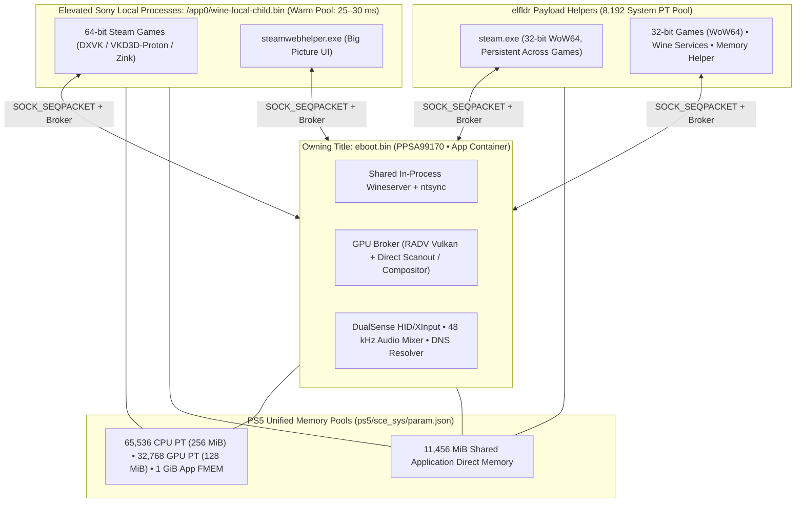

<div align="center">


# MihawkOS

**Your Windows games on the TV — with a desktop of their own around them.**
<br />
*Native PS5 homebrew running 64-bit & 32-bit Windows games on Wine + GE-Proton11-7, RADV Vulkan, built-in persistent Steam Big Picture, and a Windows-style desktop.*

<p>
  <a href="#compatibility-and-known-limits"></a>
  <a href="#architecture-overview"></a>
  <a href="NOTICE.md"></a>
</p>
<p>
  <a href="#benchmarks-and-what-runs"></a>
  <a href="#architecture-overview"></a>
  <a href="https://github.com/mihawk-99/PS5_MihawkOS/releases"></a>
  <a href="LICENSE"></a>
</p>

<p>
  <a href="https://github.com/mihawk-99/PS5_MihawkOS/releases">Download</a> •
  <a href="#highlights">Highlights</a> •
  <a href="#architecture-overview">Architecture</a> •
  <a href="#steam-built-in">Steam</a> •
  <a href="#get-started">Get Started</a> •
  <a href="#webui">WebUI</a> •
  <a href="#controls">Controls</a> •
  <a href="#compatibility-and-known-limits">Limits</a> •
  <a href="#documentation-hub">Docs</a>
</p>

<br />

<picture>
  <source media="(prefers-color-scheme: dark)" srcset="docs/media/readme/banner-night.svg" />
  
</picture>

</div>

---

> [!IMPORTANT]
> **MihawkOS is a passion project, not a piracy project.** It exists so you can play the games you own on the console you own.
> - **No games, saves, keys, firmware or exploits are included**, and they never will be.
> - **Use only games and programs you have the right to run** — your own copies, bought or installed by you.
> - **Requests for, or links to, games, keys, firmware or exploits are not welcome** in this project's issues or discussions.

---

<a id="at-a-glance"></a>

## <picture><source media="(prefers-color-scheme: dark)" srcset="docs/media/readme/orb-this-pc-night.svg"></picture> At a Glance

MihawkOS ships two things together — a **Wine + Proton runtime** engineered for PS5 hardware, and **Mihawk OS**, a Windows-style desktop with a taskbar, Start menu, File Explorer and built-in web browser. Pick a game from the controller launcher, launch directly from **Steam Big Picture**, or open the desktop like a PC.

<table>
  <tr>
    <td width="50%">
      
      <strong>64-bit &amp; 32-bit Windows Games</strong><br />
      Direct3D 9/10/11 (DXVK), Direct3D 12 (VKD3D-Proton), OpenGL 4.6 (Mesa Zink), and Media Foundation video on PS5 RADV — with the DualSense as Xbox 360, Xbox One, or DualSense.
    </td>
    <td width="50%">
      
      <strong>Persistent Steam Big Picture</strong><br />
      Guided install and one-time phone QR sign-in. Games launch straight from Big Picture without closing Steam, return directly to live Big Picture on exit, and keep Steam Cloud working.
    </td>
  </tr>
  <tr>
    <td width="50%">
      
      <strong>Mihawk OS Desktop &amp; Game Mode</strong><br />
      Taskbar, Start search &amp; pins, File Explorer, shortcuts, MihawkBrowser, and a frosted-glass on-screen keyboard. Full-screen games take direct scanout and return to the desktop when done.
    </td>
    <td width="50%">
      
      <strong>Phone &amp; PC WebUI Companion</strong><br />
      Scan a QR code to upload games, fetch cover art, create PS5 home-screen tiles, back up or restore saves as ZIPs, tweak per-game settings, and export masked bug reports.
    </td>
  </tr>
</table>

---

<a id="highlights"></a>

## <picture><source media="(prefers-color-scheme: dark)" srcset="docs/media/readme/orb-games-night.svg"></picture> What's New in Alpha 10

*Tested on a standard PS5 (firmware 13.60). PS5 Pro (10.01) verification remains pending.*

- **Native 1440p & 4K game resolution output (`#65`).** Choose `1080p`, `1440p` (`2560×1440`), or `4K` (`3840×2160`) globally in Settings, per-game in Options, or via the WebUI (localized across all 10 languages), with graceful fallback to 1080p if VideoOut declines a mode. Verified on PS5 at **120 Hz** in both `2560×1440` (`92.1 FPS`, `fast_copy=1`) and `3840×2160` (`96.1 FPS`, `fast_copy=1`).
- **Multi-controller support (2–4 DualSense) + Rumble (`#64`).** Polls up to 4 logged-in DualSense controllers with 2 s hot-plug refresh, exposes all 4 slots across XInput (`xinput1_3` 64-bit & 32-bit WoW64) and HID (`winebus.sys`), and forwards both XInput vibration and DualSense USB output report `0x02` rumble back to the console's `scePadSetVibration` (auto-muted on overlay, OSK, pause, or exit).
- **Universal elevated Sony local processes for all 64-bit apps.** Extends pre-warmed elevated local processes (`/app0/wine-local-child.bin`, `65,536 CPU / 32,768 GPU` app page tables, `0` system PT) from Steam-only to all 64-bit games, browsers, and Chromium apps, with a deterministic half-close exit flush handshake and `PW_CODE_BUDGET_EVICTED = 16384` (~256 MiB executable cache for large protected binaries).
- **Direct3D 12 Tiled Resources Tier 2 + game compatibility fixes.** Exposes D3D12 Tiled Resources Tier 2 without PRT residency queries in VKD3D-Proton (patch `0004`), fixes DXVK `dxbc-spirv` `Operand::getSwizzle()` crashes on SM3 constant-operand `texkill` (`#42`), adds `EINTR`/`EAGAIN` retry handling and foreign-mapping diagnostics (`#43`), hardens writeback flush on atomic rename/save (`#56`/`#59`), and fixes orphaned local children (`#70`) and bounded Steam shutdown.

<a id="benchmarks-and-what-runs"></a>

### Verified Base PS5 (13.60) Benchmarks

Every row below comes directly from committed console evidence in `evidence/` on a **standard PS5 (firmware 13.60)** at 120 Hz. These are measured runs, not a universal compatibility list.

| Workload | Warm Spawn | Measured Frame Rate &amp; Pacing | CPU PT Free (of 65,536) | System PT Free (of 8,192) | Memory &amp; Lifecycle |
| --- | :---: | --- | :---: | :---: | --- |
| **Elevated local-process probe** ([record](evidence/sony-local-elev-pt-probe-02.json)) | – | `jit80_value=42`, `prot=5` (`euid=0`) | `65,513 → 65,396 → 65,513` | `0` consumed | **100%** PT &amp; `1,031,798,784 B` FMEM reclaimed on close |
| **Heavy 3D 64-bit game via Steam** ([record](evidence/p3-local-village-2026-11-26-02.json)) | `30 ms` | **119.9 FPS** (`7,636` direct flips, `p99 8.75 ms`, `0` gaps ≥ 100 ms) | `62,395` (`95.2%` free; GPU `32,690/32,768`) | `3,721` | `4.5 GiB` direct memory mapped; clean exit to `11,178 MiB` free |
| **3D Direct3D 12 demo via Steam** ([record](evidence/p3-local-re3demo-2026-11-26-01.json)) | `26 ms` | **117.7 FPS** (`4,802` direct frames, verified 1080p capture) | `62,543` (`95.4%` free; GPU `32,277/32,768`) | `3,819` | `1.99 GiB` VRAM + `1.14 GiB` host DMEM; clean exit to `11,265 MiB` free |
| **2D 64-bit game launched twice in one Steam session** ([record](evidence/p3-e2e-spelunky2-twice-2026-11-26-01.json)) | `27 ms` / `30 ms` | **122.0 FPS** (#1) &amp; **122.7 FPS** (#2), live Big Picture between runs | `63,661 → 64,574 → 63,644 → 65,002` | `3,929 → 3,971` | Steam Cloud `AC Launch` &amp; `AC Exit` complete on both cycles; **0** `LoadExec` handovers |

### Platform Capabilities Proven on Console

| Area | Verified on PS5 Pro (10.01) &amp; Standard PS5 (13.40 / 13.60) |
| --- | --- |
| **Windows execution** | 64-bit PE64 and native 32-bit PE32 via WoW64; up to 8 concurrent processes; **1,337 / 1,708** Wine conformance test files match host Wine ([docs/CONFORMANCE.md](docs/CONFORMANCE.md)) |
| **Graphics** | Direct3D 9/10/11 (DXVK), Direct3D 12 feature level `12_1` (VKD3D-Proton, up to 32,768 reserved heaps), OpenGL 4.6 (Mesa Zink), and Media Foundation video; sub-1 ms direct scanout in Game Mode |
| **Steam** | Guided download, install, phone QR sign-in, persistent Big Picture across repeated 64-bit game launches with Steam Cloud sync (standard PS5 13.60); install &amp; sign-in also verified inside PS5 Pro memory limits |
| **Input &amp; audio** | DualSense as Xbox 360, Xbox One, or DualSense (runtime switchable via `L3 + R3` overlay), touchpad trackpad, USB keyboard &amp; mouse, and 48 kHz stereo audio through the title mixer |
| **Desktop &amp; network** | Taskbar, Start search/pins, File Explorer, desktop shortcuts, MihawkBrowser (CEF 150), frosted-glass OSK, real DNS (`c-ares`), HTTP, and strict GnuTLS HTTPS |

<details>
<summary><strong>Earlier release highlights (Alpha 3 – Alpha 8)</strong></summary>

- **Alpha 8 (in progress):** In-game frosted-glass control overlay (**L3 + R3**) with Exit game, live Statistics HUD (FPS, frame time, CPU, GPU, memory, and both page-table pools), on-screen keyboard, Mouse off/on toggle, and live Controller switching (Xbox 360 / Xbox One / DualSense).
- **Alpha 7.1 (tested on standard PS5 13.60):** Frosted-glass on-screen keyboard (`2–5 ms` key response, works on 13.60 without system keyboard); fixed input wake-up freeze in games; live progress &amp; signature-verified self-updater.
- **Alpha 7 (tested on PS5 Pro 10.01):** One-folder self-installing runtime inside `PPSA99170`; tile-grid main menu in 10 languages with Files browser and per-game Options; sub-1 ms frame presentation; Direct3D 12 feature level `12_1` with existing heaps; real Win32 message boxes, parent/command-line queries, and missing-DLL diagnostics; 10,000+ open files for large Steam downloads; Bubble City wallpaper by Skeuoss.
- **Alpha 4 – Alpha 6:** Adaptive per-helper code cache budget (`64 MiB` start, grows on thrash); firmware-aware memory guard; self-contained PRX loader fixing "errno 92" on firmwares 11.00–13.x; Wine conformance fixes (attributes, junctions, directory watches, 4 KiB page protection, live crash dumps, privileged instruction emulation `SGDT`/`SIDT`/`SLDT`/`SMSW`/`STR`, CJK fonts, OpenGL &amp; Vulkan present fixes).

</details>

---

<a id="architecture-overview"></a>

## <picture><source media="(prefers-color-scheme: dark)" srcset="docs/media/readme/orb-desktop-night.svg"></picture> Architecture Overview

MihawkOS isolates Windows programs in separate OS processes while the owning title (`eboot.bin`) coordinates the shared wineserver, RADV GPU broker, display scanout, DualSense input, and audio mixer. In Steam sessions, 64-bit games and Steam's browser execute in pre-warmed, Lapy-elevated Sony local processes (`/app0/wine-local-child.bin`) so they inherit the title's expanded **65,536 CPU / 32,768 GPU** application page-table pools without touching the console's 8,192-entry system pool:



- **Direct-launched 64-bit games** outside Steam continue to support MihawkOS's in-title execution route (`docs/TITLE_CLIENT.md`) or `elfldr` payload helpers (`TRIANGLE` on any tile to toggle).
- **Zero-leak cleanup:** When a local-process game exits or crashes, `sceSystemServiceKillLocalProcess` returns 100% of its page tables and flexible memory immediately without closing Steam or restarting MihawkOS.

---

<a id="steam-built-in"></a>

## <picture><source media="(prefers-color-scheme: dark)" srcset="docs/media/readme/orb-app-generic-night.svg"></picture> Steam, Built In

Select **Steam** from the launcher's library. On first launch, a guided setup in all ten languages walks you through everything automatically (requires internet and an accurate console clock; MihawkOS is not affiliated with Valve and ships nothing of Valve's):

| Step | What Happens |
| :---: | --- |
| **1. Download** | Fetches Valve's official `SteamSetup.exe` over verified TLS and validates its PE signature before running. |
| **2. Install** | Runs the silent installer (~30 seconds once your Windows drive is prepared). |
| **3. First Update** | Steam downloads and applies its own packages (~5 minutes; the guide shows live MB progress). |
| **4. Sign In Once** | Open the Steam mobile app, tap the shield icon, and scan the QR code. MihawkOS saves your session automatically. |
| **5. Big Picture** | Every future launch opens straight into **Steam Big Picture** with persistent sessions, 65,536-PT game launches, live return on exit, and **Steam Cloud** sync. |

- **Controller button prompts:** Choose **Xbox 360** (default), **Xbox One**, or **DualSense** in **Settings → Controller** (or live in-game via `L3 + R3`) so Steam and games show matching button glyphs.
- **Smooth Big Picture UI:** Steam's browser runs with an adaptive code budget and fast file/xattr/server paths (patches `2485` &amp; `2486`), cutting slow frames (>20 ms) during scrolling from `162` to `66` on standard PS5 at 120 Hz while leaving >62,000 CPU page tables free for games ([docs/STEAM.md](docs/STEAM.md)).

---

<a id="get-started"></a>

## <picture><source media="(prefers-color-scheme: dark)" srcset="docs/media/readme/orb-downloads-night.svg"></picture> Get Started

> [!WARNING]
> **Official payload set required — and nothing else.** At every launch MihawkOS verifies **Kstuff Lite 1.11 Beta+**, **elfldr**, **websrv**, and **ShadowMountPlus beta11+** (NanoDNS, klogsrv, ftpsrv, and pldmgr are optional). Extra payloads such as etaHEN hold memory games need and keep MihawkOS on its payload check. **Never load OnionHEN.** MihawkOS starts its `/data` access service (Lapy) itself — never launch a second copy.

### Installation &amp; First Launch

1. **Cold-boot and load payloads.** Never use Rest Mode (it unloads payloads; only a full restart restores them). Load **Kstuff Lite 1.11 Beta+**, **elfldr**, **websrv**, and **ShadowMountPlus beta11+**.
2. **Copy `PPSA99170`.** Extract the release archive and copy `PPSA99170/` (~0.6 GB, runtime bundled inside) to `/data/homebrew/PPSA99170/` via FTP or a console file manager. Leave ~4 GB free for the unpacked runtime and your first Windows drive. Wait ~45 seconds for ShadowMountPlus to register the tile.
3. **Complete Guided Setup.** Open **MihawkOS** from the PS5 home screen and follow the built-in setup (choose from 10 languages: English, Français, Español, Deutsch, Italiano, Русский, 简体中文, 日本語, Português (Brasil), Polski; runtime install ~1 min; Windows drive creation ~1 min; then jump straight to **Install Steam** or **Game Library**).
4. **Add games.** Launch **Steam** directly, or scan the launcher's QR code to open the **WebUI** at `http://<PS5 address>:6767`.

<details>
<summary><strong>Tested payload footprint (standard PS5, 88 MiB total)</strong></summary>

| Payload | Required | Minimum | Measured RSS | Port | Purpose |
| --- | :---: | --- | :---: | :---: | --- |
| [Kstuff Lite](https://github.com/EchoStretch/kstuff-lite) | Yes | 1.11 Beta | `7.7 MiB` | – | Kernel homebrew support |
| [elfldr](https://github.com/ps5-payload-dev/elfldr) | Yes | – | `22.8 MiB` | via websrv | Spawning `/data` daemon &amp; payload helpers |
| [websrv](https://github.com/ps5-payload-dev/websrv) | Yes | – | `v0.34, 8.2 MiB` | `8080` | Payload transport |
| [ShadowMountPlus](https://github.com/drakmor/ShadowMountPlus) | Yes | beta11 | `25.2 MiB` | `10101` | Home-screen launching &amp; WebUI game tiles |
| NanoDNS | Optional | – | `4.1 MiB` | – | Optional DNS blocker (appears as "payload" on 13.60) |
| [ftpsrv](https://github.com/ps5-payload-dev/ftpsrv) | Optional | – | `4.1 MiB` | `2121` | Copying titles, runtime, or games over LAN |
| [klogsrv](https://github.com/ps5-payload-dev/klogsrv) | Optional | – | `3.9 MiB` | `3232` | PC dev tools &amp; kernel logs |
| pldmgr | Optional | – | `12.3 MiB` | – | Payload loader manager |

</details>

---

<a id="webui"></a>

## <picture><source media="(prefers-color-scheme: dark)" srcset="docs/media/readme/orb-app-browser-night.svg"></picture> WebUI Companion &amp; Adding Games

While the launcher is open, MihawkOS serves a mobile- and desktop-friendly WebUI on port **`6767`** (scan the QR code under the library side panel or in **Settings → Web UI**). It automatically stops when a game or desktop launches so it uses zero RAM while playing.

> **Network note:** The WebUI requires a per-session CSRF token and refuses cross-origin requests, but has no login. Use it only on a trusted LAN and never forward port `6767` to the internet.

| WebUI Page | What You Can Do |
| --- | --- |
| **My games** | View every game, edit its executable/arguments/art, and configure per-game Game Mode &amp; controller type |
| **Add a game** | Upload a game folder from your phone or PC (resumes interrupted copies) with automatic `.exe` detection |
| **Picture &amp; details** | Fetch store cover art and metadata by name, or upload a custom PNG/JPEG |
| **Home screen** | Generate a native PS5 home-screen tile (`PPSA99300–PPSA99399`) that boots straight into one game |
| **Saves** | Export any game's save folder as a ZIP backup and restore it anytime |
| **Settings &amp; Help** | Mirror launcher settings and download a masked bug-report ZIP |

**Manual install via FTP:** Copy any game folder into `/data/ps5proton/prefixes/mihawk/drive_c/Games/<Name>` (`C:\Games\<Name>`). Folders with a single 64-bit or 32-bit `.exe` at the top automatically get a Mihawk OS desktop shortcut on the next launch. For multi-exe folders or custom arguments, create `/data/ps5proton/games/<id>/game.json` (or let the WebUI generate it).

<details>
<summary><strong>Manual game.json schema &amp; environment keys</strong></summary>

```json
{
  "name": "My Game",
  "detail": "Second line in the library",
  "executable": "C:\\Games\\MyGame\\MyGame.exe",
  "directory": "C:\\Games\\MyGame",
  "prefix": "mihawk"
}
```

| Key | Description |
| --- | --- |
| `name`, `detail` | Display title and subtitle (defaults to folder name). |
| `executable`, `directory` | Absolute Windows paths (`C:\...` or `Z:\...`). |
| `arguments` | Command-line string (double quotes preserve spaces). |
| `prefix` | Prefix folder ID (up to 64 chars `[A-Za-z0-9_-]`; default `mihawk`). |
| `desktop`, `launcher` | Set `false` to hide from the Mihawk OS desktop or launcher tile grid. |
| `env` | List of `"NAME=VALUE"` pairs: `WINE_PS5_GAME_MODE=1\|0`, `WINE_PS5_CONTROLLER=xbox-360\|xbox-one\|dualsense`, `WINE_PS5_OPENGL=1`, `WINE_PS5_TITLE_PROCESS=<exe>`, `WINE_PS5_HIGH_RESERVE_ELSEWHERE=0\|1`. `PROTON_*` / `MIHAWK_*` keys belong to the title. |

</details>

---

<a id="controls"></a>

## <picture><source media="(prefers-color-scheme: dark)" srcset="docs/media/readme/orb-app-generic-night.svg"></picture> Controls

| Context | Input | Action |
| --- | --- | --- |
| **Launcher** | `D-pad` / `Left Stick` + `Cross` | Navigate tiles and launch (Mihawk OS, Steam, games, WebUI QR) |
| **Launcher** | `L1` / `R1` | Previous / next library page |
| **Launcher** | `Triangle` | Per-game options (Game Mode, controller, execution mode) |
| **Launcher** | `Square` | Choose from 30 launcher themes (Gloss / Skeuomorphic default) |
| **Launcher** | `Circle` / `Options (hold 1 s)` | Back / Close launcher |
| **In-Game** | `L3 + R3` | Open frosted-glass control overlay (Exit game, live Stats HUD, OSK, Mouse toggle, Controller switch) |
| **Mihawk OS Desktop** | `Touchpad` | Trackpad cursor: click = left-click, two-finger click = right-click, hold &amp; drag = drag |
| **Mihawk OS Desktop** | `USB Keyboard &amp; Mouse` | Plug-and-play (even via USB-C hub; hot-plugged devices detected within 3 s) |
| **Mihawk OS Desktop** | `Start → End session` | Clean return to launcher (saves registry immediately; prefer over PS button) |

---

<a id="your-files"></a>

## <picture><source media="(prefers-color-scheme: dark)" srcset="docs/media/readme/orb-folder-night.svg"></picture> Your Files

`C:` inside Mihawk OS maps to `/data/ps5proton/prefixes/mihawk/drive_c`, and `Z:` maps to the console root.

```text
/data
├── homebrew/
│   ├── dev.conf                        /data access service configuration
│   ├── PPSA99170/                      MihawkOS title + wine-local-child.bin + bundled runtime
│   └── PPSA99300…PPSA99399/            WebUI-generated home-screen game tiles
└── ps5proton/
    ├── runtime/ge11-7/                 Unpacked Wine + Proton runtime
    ├── prefixes/mihawk/                Shared Windows prefix (C:\Games, Steam, saves, registry)
    ├── games/<id>/game.json            Library entries
    ├── covers/ · caches/ · logs/       Cover art, shader caches, and rotating session logs
    └── *.txt                           Saved settings (controls, Game Mode, controller, 120 Hz)
```

> [!WARNING]
> **`/data/ps5proton/prefixes/mihawk` holds your games, Steam install, and saves.** Updating MihawkOS keeps this folder intact; always back up saves via the WebUI before deleting it.

---

<a id="compatibility-and-known-limits"></a>

## <picture><source media="(prefers-color-scheme: dark)" srcset="docs/media/readme/orb-document-night.svg"></picture> Compatibility &amp; Known Limits

Tested on a **PS5 Pro (firmware 10.01)** and a **standard PS5 (firmwares 13.40 and 13.60)**. Other models and firmwares are community-reported.

- **Not supported:** Kernel-level anti-cheat (Easy Anti-Cheat, BattlEye, etc.), kernel drivers, and heavy DRM such as Denuvo. Controller rumble is not yet verified.
- **PS5 Pro memory ceiling:** The PS5 Pro's system-memory guard engages around `870 MiB` (vs `~1,800 MiB` on standard PS5). Alpha 9's elevated Sony local-process path moves 64-bit games and Steam's browser off the system pool, but has so far been verified on standard PS5 (13.60) only.
- **Pipe memory across very many starts:** The console kernel has a fixed per-boot pipe-memory budget; after very many process starts, MihawkOS prompts **Restart the PS5**.
- **Rest Mode &amp; ShadowMountPlus:** Always cold-boot after shutdown/rest mode. ShadowMountPlus beta11+ is required so other homebrew can launch cleanly after MihawkOS exits (`docs/LAUNCH_AFTER_EXIT.md`); new WebUI home-screen tiles appear a few seconds after MihawkOS closes.
- **Updating:** From 7.1 onward, MihawkOS checks for signed GitHub updates automatically (at most once per hour); you can also update manually by replacing `/data/homebrew/PPSA99170/`.

<details>
<summary><strong>Troubleshooting &amp; Bug Reports</strong></summary>

| Symptom | Fix |
| --- | --- |
| *No access to /data: …* | Verify `elfldr` and `websrv` are loaded and `dev.conf` exists; cold-boot if returning from Rest Mode. |
| *The Wine runtime is not installed …* | Re-run **Settings → Guided setup** or `tools/console-setup.py`. |
| *A program could not start … Restart the PS5* | Per-boot kernel pipe memory is exhausted; reboot the console. |
| *The PS5's memory is getting full / nearly full* | Close unused background apps or restart; the memory guard ends runaway helpers before the console stalls. |
| Black screen in a game | Toggle **Game Mode** off for that game (`Triangle` in launcher or via WebUI) and relaunch. |
| Game sees no controller | Switch **Settings → Controller** (or `L3 + R3` overlay) to **Xbox 360** or **Xbox One**. |
| Home-screen tile won't open right after install | Wait ~45 seconds for ShadowMountPlus to finish registering it. |

**Filing a bug report:** Enable **Settings → Logging**, reproduce the issue, reopen MihawkOS, and download the masked bug-report ZIP from the WebUI **Help** page (includes `logs/title-last.log`, `logs/wine-last.log`, and tail logs). Never post your console's IP address.

</details>

---

<a id="documentation-hub"></a>

## <picture><source media="(prefers-color-scheme: dark)" srcset="docs/media/readme/orb-documents-night.svg"></picture> Documentation Hub

| Document | Contents |
| --- | --- |
| [**AGENTS.md**](AGENTS.md) | Repository rules, commit gate workflow, and agent development loop |
| [**docs/ARCHITECTURE.md**](docs/ARCHITECTURE.md) | System ownership, hybrid payload + elevated Sony local-process design, memory pools, and GPU broker |
| [**docs/STEAM.md**](docs/STEAM.md) | Persistent Steam sessions, elevated local-process benchmarks, guided setup, and PS5 Pro memory notes |
| [**docs/WINDOWS_PROCESSES.md**](docs/WINDOWS_PROCESSES.md) | Payload helpers, `/app0/wine-local-child.bin`, 65,536-PT pool capacity, and diagnostics |
| [**docs/FLEXIBLE_MEMORY.md**](docs/FLEXIBLE_MEMORY.md) | Flexible memory pools, adaptive code cache budget, and the 2026-11-26 Lapy-elevated JIT breakthrough |
| [**docs/GRAPHICS_PROCESS_BROKER.md**](docs/GRAPHICS_PROCESS_BROKER.md) | Brokered RADV Vulkan, Zink OpenGL, direct scanout, and local-process CPU-only mapping fallback |
| [**docs/PLAN.md**](docs/PLAN.md) &amp; [**docs/FEATURES.md**](docs/FEATURES.md) | Current milestones, evidence index, and verified feature limits |
| [**docs/CONFORMANCE.md**](docs/CONFORMANCE.md) | Wine conformance suite results on PS5 (`1,337 / 1,708` matching test files) |
| [**docs/MIHAWK_OS.md**](docs/MIHAWK_OS.md), [**docs/WEBUI.md**](docs/WEBUI.md), [**docs/GUIDED_SETUP.md**](docs/GUIDED_SETUP.md) | Mihawk OS desktop, browser companion, and 10-language guided setup |

---

<a id="build-from-source"></a>

## <picture><source media="(prefers-color-scheme: dark)" srcset="docs/media/readme/orb-drive-night.svg"></picture> Build From Source

<details>
<summary><strong>Toolchain requirements, sibling repos, build commands &amp; runtime switches</strong></summary>

Read [AGENTS.md](AGENTS.md) first. Builds are verified on **CachyOS (Arch Linux x86_64)**; an initial build downloads >1 GB of pinned inputs and compiles Wine.

- **Compiler &amp; tools:** `clang` / `clang++` / `lld` / **LLVM 23.1.3** (exact version required for the SHA-256-pinned Lapy daemon; set `LLVM_CONFIG` if numbered), `git`, `curl`, `wget`, `unzip`, `tar`, `xz`, `zstd`, `patch`, `make`, `cmake`, `ninja`, `meson`, `pkg-config`, `autoconf`, `bison`, `flex`, `perl`, `glslang`, `cc`, zlib &amp; FreeType headers.
- **Python 3.12+:** `Pillow`, `pefile`, `fontTools`, `numpy`, `mako`, `MarkupSafe`, `PyYAML`, `packaging`, `cryptography`.
- **ImageMagick 7.1.2-32 Q16-HDRI** with `librsvg` (auto-fetched on Arch-based hosts by `tools/fetch-all.sh`).

**Clone sibling repositories beside `PS5_MihawkOS`:**

```sh
git clone https://github.com/mihawk-99/PS5_MihawkOS.git
git clone https://github.com/mihawk-99/PS5_Vulkan.git
git clone https://github.com/mihawk-99/PS5_Mesa.git
git clone https://github.com/mihawk-99/PS5_PayloadSDK.git
git clone https://github.com/mpereiraesaa/PS5-Lapy-JB-Daemon.git
```

**Fetch, build, test, and deploy:**

```sh
bash tools/fetch-all.sh                         # once: fetch & verify all pinned inputs
bash tools/build-production.sh --jobs 8         # builds dist/PPSA99170/ (incl. wine-local-child.bin) & runtime
bash tools/host-tests.sh                        # 219 host unit & integration tests
python3 tools/console-setup.py                  # deploy title + runtime and verify SHA-256 readback
python3 tools/gate.py run --name <unique-run>   # mandatory console commit gate
python3 tools/publication-check.py all          # verify zero addresses, secrets, game data or game names
```

Put your console's IP in git-ignored `../PS5_Vulkan/.env` as `PS5_HOST`. Enable repo hooks with `git config core.hooksPath tools/git-hooks`.

**Builder runtime switches (`game.json` `env`):**
- `WINE_PS5_LOCAL_GAMES=0` — disable elevated Sony local-process routing (`/app0/wine-local-child.bin`, built by `tools/build-local-child.sh`) in Steam sessions and fall back to `elfldr` helpers.
- `WINE_PS5_CODE_BUDGET_MIB=<N>` — override per-helper code-cache budget (`0` disables eviction).
- `WINE_PS5_PRX_LOADER=0` — use the kernel PRX loader instead of MihawkOS's loader for A/B testing.

</details>

<details>
<summary><strong>Authors &amp; Acknowledgements</strong></summary>

Every upstream component is pinned by revision or hash and retains its own licence ([NOTICE.md](NOTICE.md), [docs/PROVENANCE.md](docs/PROVENANCE.md)).

| Component | Project | Licence |
| --- | --- | --- |
| Title, runtime integration &amp; desktop | [Mihawk](https://github.com/mihawk-99): PS5_MihawkOS, [PS5_Vulkan](https://github.com/mihawk-99/PS5_Vulkan), [PS5_Mesa](https://github.com/mihawk-99/PS5_Mesa), [PS5_PayloadSDK](https://github.com/mihawk-99/PS5_PayloadSDK), [PS5_VKHomebrewUI](https://github.com/mihawk-99/PS5_VKHomebrewUI) | GPL-3.0-or-later (forks keep upstream licences) |
| PS5 Wine patches &amp; platform knowledge | [prospero-win](https://github.com/mpereiraesaa/prospero-win) by mpereiraesaa | LGPL-2.1-or-later |
| Wine &amp; Proton stack | [ValveSoftware/wine](https://github.com/ValveSoftware/wine) + wine-staging pinned from GE-Proton11-7 ([mihawk-99/proton-ge-custom](https://github.com/mihawk-99/proton-ge-custom), forked from [GloriousEggroll/proton-ge-custom](https://github.com/GloriousEggroll/proton-ge-custom)) | LGPL-2.1-or-later |
| Direct3D 8–12 | [DXVK](https://github.com/doitsujin/dxvk) &amp; [VKD3D-Proton](https://github.com/HansKristian-Work/vkd3d-proton) | zlib · LGPL-2.1-or-later |
| Vulkan &amp; OpenGL | Mesa RADV &amp; Zink (via PS5_Vulkan / PS5_Mesa); [PS5 OpenGL SDK](https://github.com/darkxex/ps5-opengl) 1.0.2 | MIT · GPL-3.0-or-later |
| Media, TLS, DNS &amp; Web | [FFmpeg](https://ffmpeg.org/) 8.1.3, [GnuTLS](https://gnutls.org/)/Nettle, [Mbed TLS](https://github.com/Mbed-TLS/mbedtls), [c-ares](https://github.com/c-ares/c-ares) 1.34.8, [CEF](https://github.com/chromiumembedded/cef) 150, [Wine Mono](https://gitlab.winehq.org/mono/wine-mono), [Wine Gecko](https://gitlab.winehq.org/wine/wine-gecko) | LGPL-2.1+ · Apache-2.0 · MIT · BSD-3-Clause · MPL-2.0 |
| PS5 foundation, `/data` &amp; WebUI | [PS5_VulkanTemplate](https://github.com/mihawk-99/PS5_VulkanTemplate), PS5_PayloadSDK ([ps5-payload-dev/sdk](https://github.com/ps5-payload-dev/sdk), [ps5-native-app-boilerplate](https://github.com/BlackBearReloaded/ps5-native-app-boilerplate)), [PS5-Lapy-JB-Daemon](https://github.com/mpereiraesaa/PS5-Lapy-JB-Daemon), [GNU libmicrohttpd](https://www.gnu.org/software/libmicrohttpd/) 1.0.10, [Monocypher](https://monocypher.org/), [Zstandard](https://github.com/facebook/zstd), [Aurelia](https://github.com/Drackrath/Aurelia) 0.1.40, [jsmn](https://github.com/zserge/jsmn), [QR Code generator](https://github.com/nayuki/QR-Code-generator) | MIT · GPL-3.0+ · LGPL-2.1+ · BSD |
| Fonts, icons, theme &amp; wallpaper | ICU 68, Liberation, Source Han Sans, Noto Sans, Ume, Selawik/Proton UI, Fluent System Icons, Cascadia Mono, flag-icons, Wine Light / Mihawk Light, *Bubble City* by Skeuoss (used with permission; not open-licensed) | OFL-1.1 · MIT · Apache-2.0 · LGPL-2.1+ · Permission |

</details>

---

<a id="license-and-third-party-terms"></a>

## License &amp; Legal

**MihawkOS** is free software licensed under the **GNU General Public License v3.0 or later** ([LICENSE](LICENSE), [LICENSING.md](LICENSING.md); patches to upstream projects retain their upstream licences, including LGPL-2.1-or-later for Wine patches). All upstream notices ship beside the binaries in `licenses/` and `share/licenses/`.

No games, saves, keys, firmware or exploits are included, and piracy is not condoned ([LEGAL.md](LEGAL.md)). MihawkOS is an independent homebrew project not affiliated with, sponsored by, or endorsed by Sony Interactive Entertainment, Microsoft, Valve, or any game publisher. PlayStation, PS5, and DualSense are trademarks of Sony Interactive Entertainment Inc.; Windows is a trademark of Microsoft Corporation; Steam and Proton are trademarks of Valve Corporation. Mihawk OS contains no proprietary Microsoft code, fonts, icons, wallpapers, or sounds.

<p align="center">made by <a href="https://github.com/mihawk-99">Mihawk</a> · Built on the work of the Wine, Proton and PS5 homebrew communities.</p>
